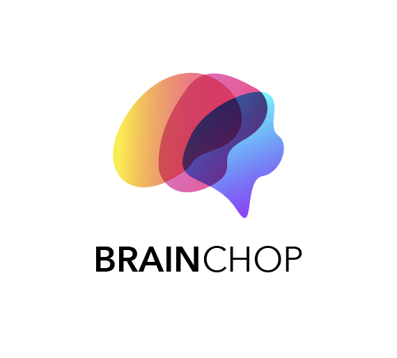

<p align="center">
  <a href="https://brainchop.org">
    
  </a>
</p>

<h1 align="center">BrainChop</h1>

<p align="center">
  <strong>Local, privacy-first 3D MRI brain segmentation and skull stripping in the browser.</strong>
</p>

<p align="center">
  <a href="https://brainchop.org"><strong>brainchop.org</strong></a> &middot;
  <a href="https://www.npmjs.com/package/@brainchop/core"><code>@brainchop/core</code></a> &middot;
  <a href="https://github.com/neuroneural/brainchop-core">Core Engine / CLI / Python</a> &middot;
  <a href="https://huggingface.co/neuroneural/mindgrab">Hugging Face Model</a> &middot;
  <a href="https://huggingface.co/spaces/neuroneural/mindgrab">HF Space</a> &middot;
  <a href="https://brainchomp.org">Brainchomp (Rodent MRI)</a> &middot;
  <a href="https://neuroneural.net/brainchop-legacy/">Legacy v3 (TF.js)</a>
</p>

BrainChop runs 3D MeshNet volumetric segmentation entirely on the user's device via [`@brainchop/core`](https://www.npmjs.com/package/@brainchop/core) (pure-JS WebGPU V4 with automatic low-memory staging, WebGL2 fallback, and multi-threaded WebAssembly CPU fallback) and renders multiplanar + 3D views with [NiiVue](https://github.com/niivue/niivue). Your scans never leave your device, and zero client-side analytics scripts are loaded.

## Models

- **🪓🧠 Omnimodal Skull Stripping** (`mindgrab`) — Modality-agnostic skull stripping & brain masking (T1, T2, FLAIR, DWI, EPI, MRA, PDw, qT1, CT, PET) · [Hugging Face Model](https://huggingface.co/neuroneural/mindgrab) · [Interactive HF Space](https://huggingface.co/spaces/neuroneural/mindgrab)
- **🪓 Subcortical + Tissue** (`mindmap`) — Primary 18-class cortical & subcortical parcellation
- **⅔🧠 Tissue fraction maps (GM/WM/CSF)** (`mindmap` PVE) — Continuous GM/WM/CSF partial-volume estimation (experimental)
- **🪓🔪 Desikan-Killiany Atlas** (`mindsnap`) — 104-region Desikan-Killiany cortical + subcortical + 5-part corpus callosum parcellation
- **⚡🪓 Subcortical + Tissue (fast)** (`mindmap-fast`) — Fast lightweight 18-class parcellation

*Icon key:* 🪓 robust models &middot; ⚡ fast lightweight model &middot; 🔪 sharp high-detail cortical parcellation.

*Intended for research and educational use; not cleared as a medical device for clinical diagnosis.*

## Development

```bash
npm install
npm run dev         # Local dev server with COOP/COEP headers for threaded CPU WASM
npm run build       # Production build -> dist/
npm run test:unit   # Pure module unit tests
npm run test:e2e    # Real-browser Playwright E2E suite (WebGPU, WebGL2, CPU WASM, Offline PWA)
```

### URL Flags for Power Users

- `?model=mindgrab|mindmap|pve|mindsnap|mindmap-fast` — Auto-run a model on load
- `?backend=auto|webgpu|webgl2|cpu` — Force a specific compute backend
- `?webgpuMode=auto|standard|low-memory|recalibrate` — Override WebGPU V4 memory/pacing auto-detection
- `?viewer=webgl2|webgpu` — Select NiiVue's viewer renderer
- `?ct=1`, `?comply=1`, `?border=<mm>`, `?legacyCleanup=1` — Optional preprocessing / postprocessing flags

## Sibling Project: Brainchomp (Rodent MRI)

Working with mouse or rat brain MRI? Try our sibling app **[Brainchomp](https://brainchomp.org/)** ([`neuroneural/brainchomp`](https://github.com/neuroneural/brainchomp)) for privacy-first in-browser rodent brain extraction and interactive 3D mask sculpting.

## Legacy BrainChop v3

Historical TensorFlow.js models and the full pre-v4 repository history are archived at [`neuroneural/brainchop-legacy`](https://github.com/neuroneural/brainchop-legacy) and accessible via [`brainchop.org/v3/`](https://brainchop.org/v3/).

## Citations

1. **BrainChop Edge Ecosystem (primary `brainchop.org` reference):**
   Sergey M. Plis, Mohamed Masoud, Farfalla Hu, Taylor Hanayik, Satrajit S. Ghosh, Chris Drake, Roger Newman-Norlund, and Christopher Rorden. *Brainchop: Providing an edge ecosystem for deployment of neuroimaging artificial intelligence models.* Aperture Neuro, 4, 2024. [DOI: 10.52294/001c.123059](https://doi.org/10.52294/001c.123059)

2. **MindGrab (`mindgrab` skull stripping):**
   Armina Fani, Mike Doan, Isabelle Le, Alex Fedorov, Malte Hoffmann, Chris Rorden, and Sergey Plis. *MindGrab: A spectrally-motivated architecture for accessible deep learning in neuroimaging.* NeuroImage, 338:122074, 2026. [DOI: 10.1016/j.neuroimage.2026.122074](https://doi.org/10.1016/j.neuroimage.2026.122074)

3. **Original BrainChop Software Paper:**
   Mohamed Masoud, Farfalla Hu, and Sergey Plis. *Brainchop: In-browser MRI volumetric segmentation and rendering.* Journal of Open Source Software, 8(83):5098, 2023. [DOI: 10.21105/joss.05098](https://doi.org/10.21105/joss.05098)

## License

MIT — see [LICENSE](LICENSE).
